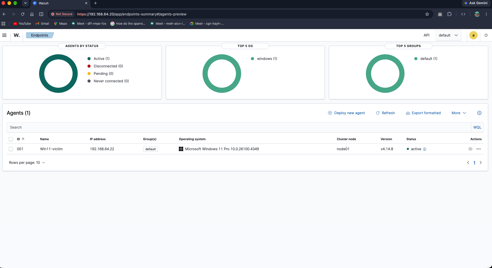
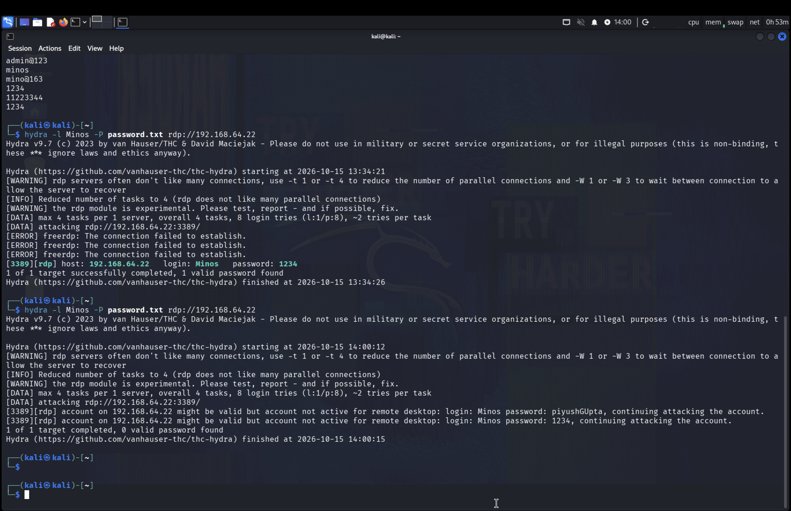
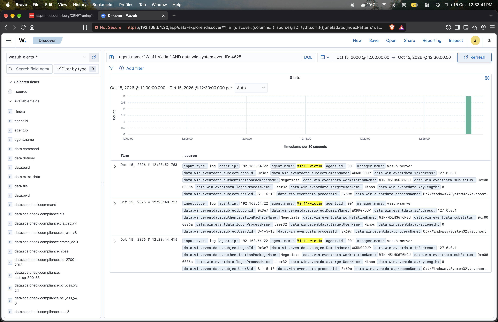
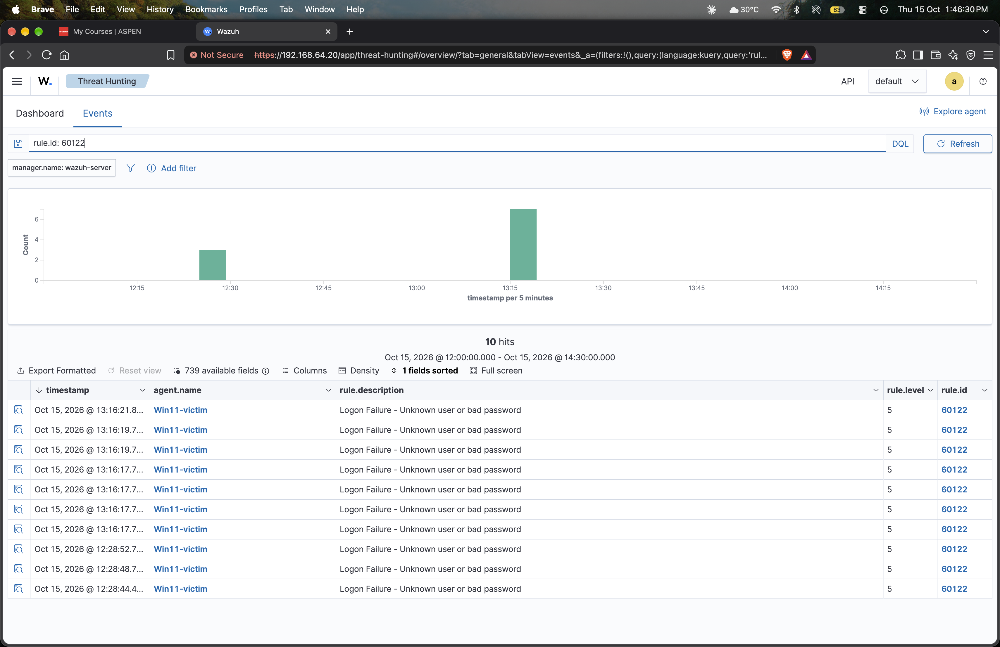
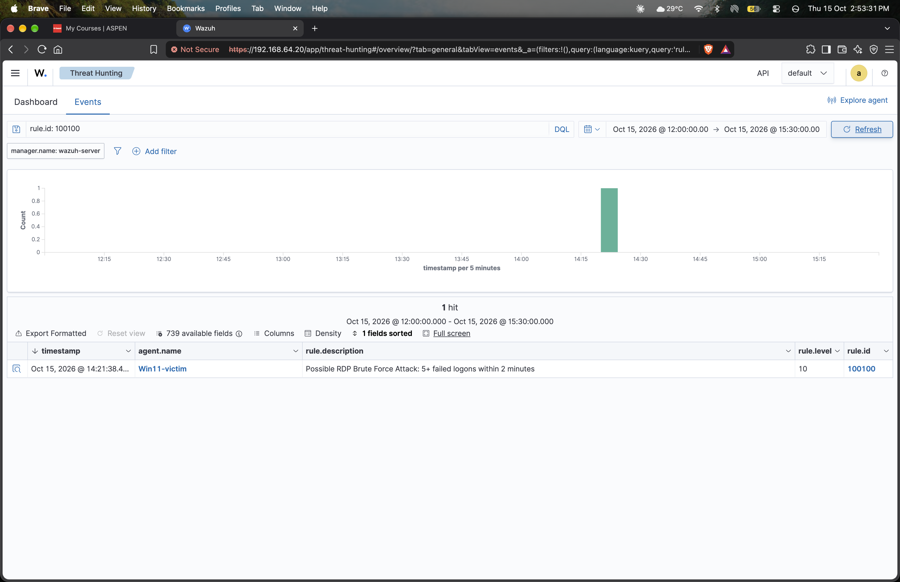
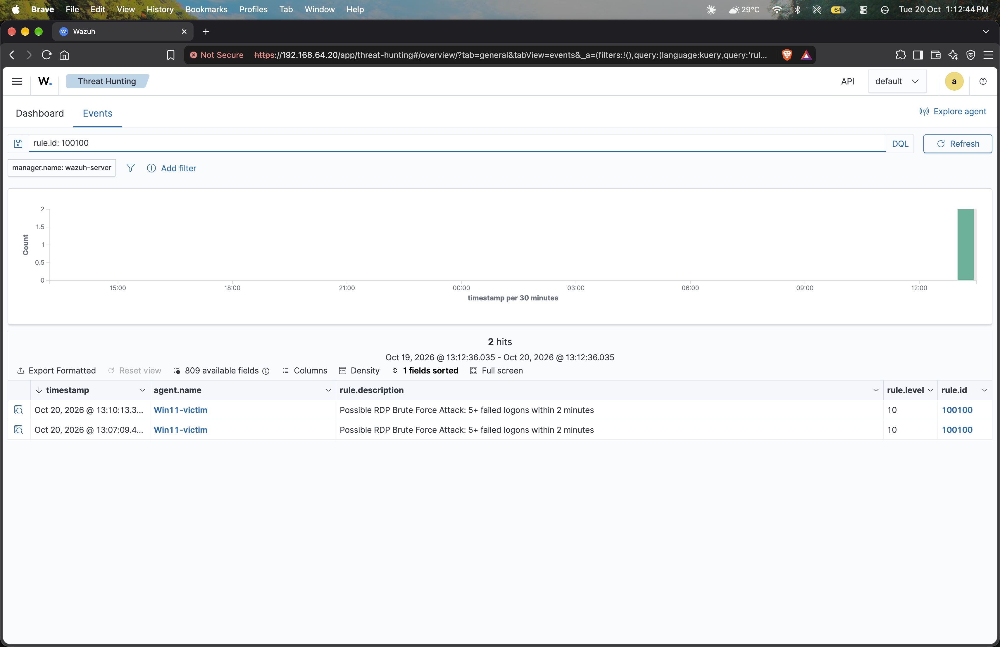
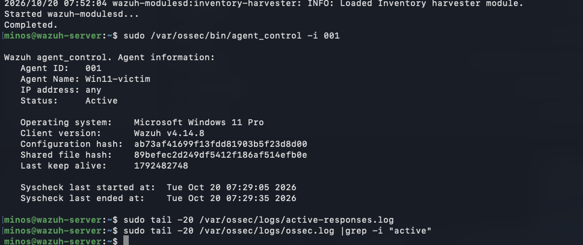
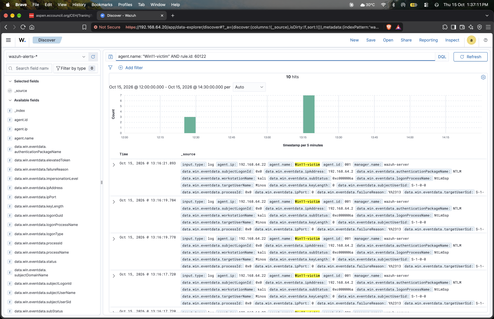

# SOC Home Lab: Wazuh SIEM — RDP Brute-Force Detection & Custom Correlation Rule


**Author:** Minos
**Stack:** Wazuh 4.14.8 (Indexer + Manager + Dashboard) · Ubuntu 26.04 LTS · Windows 11 Pro · Kali Linux · UTM (Apple Silicon)

> A self-contained SOC home lab built to detect, correlate, and investigate a real brute-force attack, using an open-source SIEM deployed entirely from scratch — including an original custom detection rule, MITRE ATT&CK mapping, and a documented platform limitation discovered while building automated response.

---

## Table of Contents
- [Overview](#overview)
- [Architecture](#architecture)
- [Lab Setup](#lab-setup)
- [Attack Scenario](#attack-scenario--rdp-brute-force-mitre-attck-t1110)
- [Detection](#detection)
- [Active Response & Known Limitation](#active-response--attempted--documented-limitation)
- [Troubleshooting Log](#troubleshooting-log)
- [MITRE ATT&CK Mapping](#mitre-attck-mapping)
- [Future Improvements](#future-improvements)
- [Resume Summary](#resume--portfolio-summary)

---

## Overview

This project demonstrates the full detection lifecycle an analyst is expected to understand:

1. Deploy and harden a 3-tier SIEM stack (Indexer, Manager, Dashboard)
2. Onboard a Windows endpoint and verify end-to-end log ingestion
3. Simulate a real attack technique — **MITRE ATT&CK T1110: Brute Force**
4. Confirm detection via Wazuh's default ruleset
5. Author and validate a **custom frequency-based correlation rule**
6. Attempt automated response (Active Response) and document a genuine platform limitation discovered along the way
7. Produce a full evidence trail suitable for an incident report

---

## Architecture

```
                 ┌─────────────────────────┐
                 │   Ubuntu 26.04 LTS       │
                 │   Wazuh Manager          │
                 │   + Indexer + Dashboard  │
                 │   192.168.64.20          │
                 └───────────▲──────────────┘
                             │ Agent traffic (TCP/1514, 1515)
                             │
        ┌────────────────────┴───────────────────┐
        │                                         │
┌───────▼────────┐                       ┌────────▼────────┐
│ Windows 11 Pro  │                       │  Kali Linux     │
│ Wazuh Agent     │◄──── RDP (3389) ──────┤  Attacker       │
│ "Win11-victim"  │      Hydra brute      │  192.168.64.2   │
│ 192.168.64.22   │      force            │                 │
└─────────────────┘                       └─────────────────┘
```

All VMs run on UTM (QEMU) on Apple Silicon, connected via a Shared Network (NAT) so the lab is fully isolated from the host's real network.

| Tool | Purpose |
|---|---|
| **Wazuh 4.14.8** | SIEM — log collection, correlation, alerting, dashboard |
| **Ubuntu Server 26.04 LTS** | Wazuh manager host |
| **Windows 11 Pro** | Monitored endpoint (victim) |
| **Kali Linux** | Attacker machine |
| **Hydra v9.7** | RDP brute-force tool |
| **UTM / QEMU** | Virtualization on macOS (Apple Silicon) |

---

## Lab Setup

- Installed Wazuh manager, indexer, and dashboard on Ubuntu via the official install script (`-a -i` flags used to bypass a conservative OS-version check on Ubuntu 26.04, newer than Wazuh's officially tested list).
- Deployed the Wazuh agent on Windows 11 Pro and verified connectivity.
- Enabled Windows **Logon** auditing so failed/successful authentication events (Event IDs 4625 / 4624) are generated — this is disabled by default on a fresh Windows install:
  ```powershell
  auditpol /set /subcategory:"Logon" /success:enable /failure:enable
  ```
- Enabled RDP on the Windows endpoint to create a realistic, network-exposed attack surface.
- Verified end-to-end log flow: Windows Security Event Log → Wazuh Agent → Wazuh Manager → Indexer → Dashboard.


*Windows 11 agent ("Win11-victim") successfully onboarded and reporting Active status in the Wazuh dashboard.*

---

## Attack Scenario — RDP Brute Force (MITRE ATT&CK T1110)

From Kali, a brute-force attack was launched against the Windows RDP service using Hydra:

```bash
hydra -l Minos -P wordlist.txt -t 1 -w 2 rdp://192.168.64.22
```

**Observed outcomes:**
- Multiple `Logon Failure – Unknown user or bad password` events generated (Windows Event ID 4625).
- Windows' built-in **account lockout policy** triggered mid-attack, blocking further attempts until the account was unlocked — a real defensive control observed in action during testing.
- A successful credential guess was captured and detected by Wazuh's own NTLM / pass-the-hash heuristic rule.


*Hydra executing the brute-force attack from Kali against the Windows RDP service, recovering a valid credential.*


*Raw Event ID 4625 ("account failed to log on") as ingested by Wazuh, showing the attacker's source IP (192.168.64.2), workstation name ("kali"), and targeted account ("Minos").*

---

## Detection

### Default Detection (built-in rule)

Wazuh's default ruleset immediately flagged the failed logons, no custom configuration required:

| Rule ID | Level | Description |
|---|---|---|
| `60122` | 5 | Logon Failure – Unknown user or bad password |
| `92657` | 6 | Successful Remote Logon Detected – possible pass-the-hash / RDP connection |


*10 instances of rule 60122 ("Logon Failure") triggered by the brute-force attack, correctly attributed to agent "Win11-victim".*

### Custom Correlation Rule (authored for this project)

Rather than rely solely on per-event alerts, a custom frequency-based correlation rule was written to detect the **pattern** of a brute-force attack (5+ failures inside a 2-minute window), mapped to MITRE ATT&CK:

```xml
<!-- /var/ossec/etc/rules/local_rules.xml -->
<group name="local,syslog,sshd,">

  <rule id="100100" level="10" frequency="5" timeframe="120">
    <if_matched_sid>60122</if_matched_sid>
    <description>Possible RDP Brute Force Attack: 5+ failed logons within 2 minutes</description>
    <mitre>
      <id>T1110</id>
    </mitre>
    <group>authentication_failures,</group>
  </rule>

</group>
```

Full file: [`config/local_rules.xml`](config/local_rules.xml)

**Validated result:** rule `100100` fired correctly during live testing (confirmed in `/var/ossec/logs/alerts/alerts.log`), escalating a cluster of low-severity events into a single, high-confidence (level 10) alert tagged with **MITRE T1110 – Credential Access / Brute Force**.


*Custom rule 100100 firing: "Possible RDP Brute Force Attack: 5+ failed logons within 2 minutes", rule level 10, tagged with MITRE T1110.*


*Custom rule 100100 reproduced on a second independent attack run, confirming the rule is reliable and repeatable.*

---

## Active Response — Attempted & Documented Limitation

An automated response was configured to block the attacker's IP via Windows Firewall whenever rule `100100` fired. Full config: [`config/ossec-active-response-snippet.xml`](config/ossec-active-response-snippet.xml)

```xml
<command>
  <name>netsh-win</name>
  <executable>netsh.exe</executable>
  <timeout_allowed>yes</timeout_allowed>
</command>

<active-response>
  <disabled>no</disabled>
  <command>netsh-win</command>
  <location>all</location>
  <rules_id>100100</rules_id>
  <timeout>300</timeout>
</active-response>
```

**Finding:** the response script consistently failed with `Cannot read 'srcip' from data`. Investigation — including cross-referencing official Wazuh community reports — confirmed this is a **known platform limitation**: Windows agents using the modern `eventchannel` log collection format report the source IP under `data.win.eventdata.ipAddress`, not the generic `srcip` field that Wazuh's built-in `netsh.exe` / `route-null.exe` Active Response scripts expect. The legacy `eventlog` collection format does populate `srcip` via a built-in decoder, but requires reconfiguring the agent's log source — a change attempted but not completed within the project timeline.


*Diagnostic session confirming the Windows agent was healthy and connected while isolating the Active Response failure to the srcip field mapping, not an agent connectivity issue.*

This was documented as a **known limitation and planned remediation** rather than left as an unexplained failure — reflecting the kind of root-cause documentation expected in real SOC engineering work.

---

## Troubleshooting Log

| Issue | Root Cause | Resolution |
|---|---|---|
| VM clock drift causing misaligned log timestamps | Windows VM clock not synced after extended pause/resume | Resynced via `w32tm /resync` and `Set-Date`; verified against host clock |
| Windows auditing disabled by default | Fresh Windows installs do not audit logon events | Enabled via `auditpol /set /subcategory:"Logon" /success:enable /failure:enable` |
| Account lockout halting repeated test attacks | Windows' built-in lockout policy triggered after N failed logons | Diagnosed via `net user Minos` (`Account active: Locked`); unlocked and adjusted lockout threshold for lab testing |
| Custom rule silently not firing | Duplicate rule ID `100100` defined twice in `local_rules.xml`; only the first was loaded | Diagnosed via `ossec.log` "Rule ID duplicated" warning; removed the duplicate block |
| Active Response failing with no visible error in dashboard | `netsh.exe` script requires the generic `srcip` field, unavailable for EventChannel-sourced Windows logs | Root-caused via `active-responses.log` on the agent; cross-referenced official Wazuh community threads; documented as a platform limitation |
| Wazuh manager service entered `failed` state | A malformed custom decoder file (`local_decoder.xml`) left `analysisd` unable to start | Diagnosed via `journalctl -xeu wazuh-manager.service`; removed the broken decoder; restarted cleanly |


*Timeline view of rule 60122 alerts clustering around each attack window, used to correlate attack bursts against the system clock.*

---

## MITRE ATT&CK Mapping

| Technique | ID | Observed Behavior |
|---|---|---|
| Brute Force | **T1110** | Repeated RDP authentication attempts from Kali against Windows 11 |
| Valid Accounts | T1078 | Successful logon following brute-force (rule 92657) |

---

## Future Improvements

- Reconfigure the Windows agent to use the `eventlog` format (or write a manager-side integration script that forwards the IP) to unblock full Active Response.
- Extend coverage with a File Integrity Monitoring (FIM) demo and a Linux SSH brute-force scenario.
- Add Sysmon for deeper Windows process-level telemetry.
- Build a custom Active Response script that reads `data.win.eventdata.ipAddress` directly, bypassing the `srcip` limitation.

---

## Resume / Portfolio Summary

> Built a SOC home lab using Wazuh SIEM across a 3-VM environment (Ubuntu manager, Windows 11 agent, Kali attacker); authored a custom frequency-based correlation rule (5+ failed RDP logons within 120s) mapped to MITRE ATT&CK T1110, validated against a live Hydra brute-force attack; diagnosed and documented a Wazuh Active Response platform limitation related to Windows EventChannel log collection.

---

## Disclaimer

This lab was built entirely on isolated, self-owned virtual machines for educational purposes. No attacks were performed against systems without authorization.
